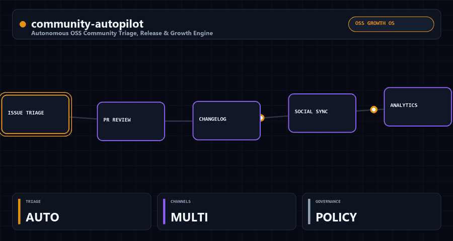

<div align="center">


<br/>


<br/><br/>

[](https://github.com/benni-os/community-autopilot/actions/workflows/test.yml)
[](#-testing--code-quality)
[](docker/Dockerfile)
[](https://www.python.org/)
[](https://mypy-lang.org/)
[](LICENSE)
[](https://benni-os.net)

<br/>

> **"Zero unanswered issues. Every open-source contributor treated like an enterprise VIP."**


<br/>



<br/>

</div>

<br/>

## 🌟 Key Features

- **⚡ Autonomous Issue & Comment Triage:** Continuously scans configured repositories for unanswered issues and pending contributor questions.
- **🧠 Contextual LLM Responses:** Drafts helpful, maintainer-voiced responses using NEMESIS Nexus or local LLM backends with smart SLA prioritization (`CRITICAL`, `HIGH`, `MEDIUM`, `LOW`).
- **🛡️ Multi-tier Safety Gates:**
  - Strict maintainer verification to prevent self-responding.
  - `--dry-run` simulation mode for zero-risk inspection.
  - Mandatory approval gate for high-priority or sensitive tickets.
  - Hard caps on comments and budget per execution cycle.
- **📡 Real-time GitHub Webhook Server:** Built-in FastAPI server with HMAC-SHA256 signature verification for instant issue reaction.
- **📊 NEMESIS Event Bus Integration:** Complete action provenance, cost attribution, and audit trail snapshots logged directly to NEMESIS.
- **💬 Slack Operations Notifications:** Real-time channel alerts for run summaries and drafts awaiting manual maintainer approval.

---

## 🏗️ Architecture

```text
  GitHub Repositories (Issues / Comments / Pull Requests)
         │
         ├──► Polling / Cron  GitHubWatcher (autopilot scan | run)
         └──► Real-Time HTTP  Webhook Server (FastAPI :8000, HMAC-SHA256)
                       │
                       ▼
  ┌─────────────────────────────────────────────────────────────────────┐
  │                         community-autopilot                         │
  │                                                                     │
  │  ┌───────────────────┐  ┌───────────────────┐  ┌─────────────────┐  │
  │  │ SLA Prioritizer   │  │  NEMESIS Nexus    │  │ Multi-Tier      │  │
  │  │ & Context Builder │─►│  LLM Draft        │─►│ Safety Gates    │  │
  │  │ • CRITICAL / HIGH │  │  Generator        │  │ • Approval Gate │  │
  │  │ • MEDIUM / LOW    │  │  • Maintainer     │  │ • Budget & Caps │  │
  │  └───────────────────┘  │    Voice Prompts  │  └─────────────────┘  │
  │                         └───────────────────┘           │           │
  │  ┌───────────────────┐  ┌───────────────────┐  ┌────────▼────────┐  │
  │  │ GitHub Responder  │  │  NEMESIS Event    │  │ Live Telemetry  │  │
  │  │ • Dry-Run / Post  │◄─│  Bus & Slack      │◄─│ & Doctor /      │  │
  │  │ • Self-Reply Lock │  │  • Audit Trace    │  │ Bench Matrix    │  │
  │  └───────────────────┘  └───────────────────┘  └─────────────────┘  │
  └─────────────────────────────────────────────────────────────────────┘
         │                                         │
         ▼                                         ▼
   GitHub Issue Comment                      NEMESIS Audit Snapshot
   (Approved Maintainer Reply)               & Slack Ops Notification
```

---

## 🚀 Quickstart

### Prerequisites

- Python `>= 3.12`
- [uv](https://docs.astral.sh/uv/) (recommended) or `pip`

### 1. Clone & Install

```bash
git clone https://github.com/benni-os/community-autopilot.git
cd community-autopilot

# Install dependencies and editable package
uv sync --all-extras
```

### 2. Configure Environment

Copy `.env.example` to `.env` and fill in your credentials:

```bash
cp .env.example .env
```

```env
# GitHub
GITHUB_TOKEN=ghp_your_personal_access_token
GITHUB_ORG=benni-os

# NEMESIS
NEMESIS_URL=https://nemesis.benni.os
NEMESIS_API_KEY=your_nemesis_key
TENANT_ID=benni-os

# Slack (optional)
SLACK_WEBHOOK_URL=https://hooks.slack.com/services/xxx
SLACK_CHANNEL=#community

# Webhook Server
WEBHOOK_SECRET=your_github_webhook_secret
```

---

## 💻 CLI Usage

The package provides the `autopilot` command:

```bash
# 1. Pre-flight health and configuration check
autopilot health

# 2. Scan issues in dry-run mode (preview drafts without posting)
autopilot scan --dry-run

# 3. Scan a specific repository
autopilot scan --dry-run --repo mcp-forge

# 4. Execute a full triage run
autopilot run --max 10

# 5. Review & explicitly approve an issue draft
autopilot approve --repo mcp-forge --issue 42 --message "Thanks for raising! We are reviewing."

# 6. Launch the real-time GitHub Webhook server
autopilot serve --host 0.0.0.0 --port 8000
```

---

## 🐳 Docker & Kubernetes Deployment

### Run with Docker

```bash
# Build Docker image
docker build -t community-autopilot -f docker/Dockerfile .

# Run one-off scan
docker run --rm --env-file .env community-autopilot scan --dry-run

# Run webhook daemon
docker run -d -p 8000:8000 --env-file .env community-autopilot serve
```

### Kubernetes

Manifests are provided in `k8s/`:

```bash
# 1. Apply secrets
kubectl apply -f k8s/secret.yaml -n benni-os

# 2. Deploy Webhook Server (Continuous)
kubectl apply -f k8s/deployment.yaml -n benni-os
kubectl apply -f k8s/service.yaml -n benni-os

# 3. Or deploy as a Scheduled CronJob (Runs every 6 hours)
kubectl apply -f k8s/cronjob.yaml -n benni-os
```

---

## 🧪 Testing & Code Quality

The codebase enforces strict type safety and quality standards:

```bash
# Run tests with coverage (>90% required)
uv run pytest

# Run Ruff linter and formatter
uv run ruff check src/ tests/

# Run MyPy in strict mode
uv run mypy --strict src/ tests/
```

---

## 📁 Project Structure

```text
community-autopilot/
├── src/
│   └── community_autopilot/
│       ├── __init__.py               # Public package exports
│       ├── py.typed                  # PEP 561 strict typing marker
│       ├── analyzer.py               # SLA prioritizer & LLM context builder
│       ├── cli.py                    # Typer CLI (health, scan, run, approve, serve)
│       ├── config.py                 # Pydantic-settings configuration
│       ├── models.py                 # Issue, Comment, Priority & DraftResponse models
│       ├── nemesis.py                # NEMESIS Event Bus & Nexus client
│       ├── prompts.py                # Maintainer system & user prompt templates
│       ├── responder.py              # GitHub responder with safety & budget gates
│       ├── slack.py                  # Slack operations alert notifier
│       ├── watcher.py                # GitHub repository issue/comment poller
│       ├── webhook.py                # FastAPI HMAC-SHA256 webhook server
│       ├── core/
│       │   └── __init__.py           # Core triage & domain subpackage exports
│       ├── serve/
│       │   ├── __init__.py           # Webhook, NEMESIS, Slack & telemetry exports
│       │   └── telemetry.py          # P50/P90/P99 triage latency & SLA tracker
│       └── tools/
│           ├── __init__.py           # Diagnostics & benchmark subpackage exports
│           ├── bench_matrix.py       # Multi-batch issue triage benchmark matrix
│           └── doctor.py             # Runtime dependency, SLA & HMAC probe
├── docs/
│   └── ARCHITECTURE.md               # Detailed triage & subpackage architecture spec
├── examples/
│   ├── quickstart_triage.py          # Minimal issue SLA prioritization example
│   └── webhook_telemetry_demo.py     # Webhook HMAC verification + TelemetryEngine
├── scripts/
│   ├── benchmark_triage.py           # Issue triage throughput benchmark runner
│   └── gate_webhook_hmac.py          # HMAC-SHA256 webhook signature gate script
├── docker/                           # Dockerfile & docker-compose.yml
├── k8s/                              # Kubernetes deployment, service, secret & cronjob
└── tests/                            # Full pytest suite (49 tests)
```

---

## 🌐 The Benni OS Open-Source Ecosystem

`community-autopilot` is part of the coordinated **Benni Master OS v9.4** open-source infrastructure suite:

| Repository | Focus & Architecture | Stars |
| :--- | :--- | :---: |
| **[`conductor-sdd`](https://github.com/Benni-OS/conductor-sdd)** | Zero-Dependency Spec-Driven Development, Static AST Drift Detector & MCP Guardrail | [](https://github.com/Benni-OS/conductor-sdd) |
| **[`benni-inference-engine`](https://github.com/Benni-OS/benni-inference-engine)** | High-Throughput Sovereign Local Inference for 8GB–16GB Consumer GPUs | [](https://github.com/Benni-OS/benni-inference-engine) |
| **[`agent-eval-harness`](https://github.com/BenniAlencar/agent-eval-harness)** | Deterministic Zero-Cloud Agent Evaluation, Red-Teaming & Benchmark Harness | [](https://github.com/BenniAlencar/agent-eval-harness) |
| **[`agent-code-sandbox`](https://github.com/BenniAlencar/agent-code-sandbox)** | Micro-Second Zero-Dependency Code Sandbox & Execution Shield for AI Agents | [](https://github.com/BenniAlencar/agent-code-sandbox) |
| **[`agent-deep-research`](https://github.com/BenniAlencar/agent-deep-research)** | Autonomous Multi-Source Deep Research & Evidence Synthesis Engine | [](https://github.com/BenniAlencar/agent-deep-research) |
| **[`agent-browser-mesh`](https://github.com/BenniAlencar/agent-browser-mesh)** | Token-Saving Resilient Headless Browser Automation & A11y DOM Compiler | [](https://github.com/BenniAlencar/agent-browser-mesh) |
| **[`agent-intent-compiler`](https://github.com/BenniAlencar/agent-intent-compiler)** | Deterministic Intent Compiler & Typed DAG Execution Planner for AI Agents | [](https://github.com/BenniAlencar/agent-intent-compiler) |
| **[`agent-token-optimizer`](https://github.com/BenniAlencar/agent-token-optimizer)** | Sub-Millisecond Context Compression & Semantic Deduplication Engine | [](https://github.com/BenniAlencar/agent-token-optimizer) |
| **[`bio-sync-operator-os`](https://github.com/BenniAlencar/bio-sync-operator-os)** | Real-Time Biometric Swarm Governance & 120 FPS Resonant Kinetic Interface | [](https://github.com/BenniAlencar/bio-sync-operator-os) |
| **[`agent-cyber-sentinel`](https://github.com/BenniAlencar/agent-cyber-sentinel)** | Zero-Trust Runtime Security, Prompt Injection Firewall & Secrets Redaction | [](https://github.com/BenniAlencar/agent-cyber-sentinel) |
| **[`agent-run-ledger`](https://github.com/BenniAlencar/agent-run-ledger)** | Deterministic Multi-Step Task Execution Ledger & Anti-Looping Engine | [](https://github.com/BenniAlencar/agent-run-ledger) |
| **[`reality-lock`](https://github.com/BenniAlencar/reality-lock)** | Cryptographic State Verification & Invariant Proof Engine for Agents | [](https://github.com/BenniAlencar/reality-lock) |
| **[`agent-memory-mesh`](https://github.com/BenniAlencar/agent-memory-mesh)** | Hybrid Vector + BM25 Hierarchical Session Memory & Continuity Engine | [](https://github.com/BenniAlencar/agent-memory-mesh) |
| **[`benni-operator-gateway`](https://github.com/Benni-OS/benni-operator-gateway)** | Human-in-the-Loop Approval & Policy Enforcement Gateway | [](https://github.com/Benni-OS/benni-operator-gateway) |
| **[`mcp-forge`](https://github.com/Benni-OS/mcp-forge)** | Rapid Model Context Protocol (MCP) Server Scaffolding & Dynamic Tooling | [](https://github.com/Benni-OS/mcp-forge) |
| **[`benni-nexus`](https://github.com/Benni-OS/benni-nexus)** | Autonomous Multi-Agent Intent Routing & Swarm Coordination Hub | [](https://github.com/Benni-OS/benni-nexus) |
| **[`community-autopilot`](https://github.com/Benni-OS/community-autopilot)** | Autonomous GitHub Community Triaging & PR Feedback Agent | [](https://github.com/Benni-OS/community-autopilot) |

---

## 🏛️ Commercial & Sovereign Architecture

Need autonomous multi-agent swarm orchestration, private datacenter infrastructure, or enterprise governance?

- **Official Website:** [https://benni-os.net](https://benni-os.net)
- **Operator Mode Playbook:** [https://benni-os.net/blog/academy.html](https://benni-os.net/blog/academy.html)
- **GitHub Organization:** [https://github.com/Benni-OS](https://github.com/Benni-OS)
- **Maintainer:** [Benni Alencar](https://github.com/BenniAlencar)

---

## 📄 License & Provenance

- **License:** [MIT License](LICENSE)
- **Author:** Benni Alencar (`bennialencar@benni-os.net`)
- **Architecture:** Benni Master OS v9.4 Tier-0 Governance Standard

<div align="center">


**community-autopilot** — *Autonomous Community Care by [Benni OS](https://github.com/Benni-OS)* • [benni-os.net](https://benni-os.net) • `MIT License`

`AUTONOMOUS_TRIAGE` • `NEMESIS_TRACING` • `SLA_CLASSIFIER` • `SLACK_ALERTS` • `MIT_LICENSE`

Engineered by **Benni Alencar** and the Benni OS Core Engineering Group

</div>
