<div align="center">


<br/>


<br/><br/>

[](https://github.com/benni-os/community-autopilot/actions/workflows/test.yml)
[](docker/Dockerfile)
[](https://www.python.org/)
[](https://mypy-lang.org/)
[](LICENSE)
[](https://github.com/benni-os)

<br/>

> **"Zero unanswered issues. Every open-source contributor treated like an enterprise VIP."**


<br/>



<br/>

</div>

<br/>

## 🌟 Key Features

- **⚡ Autonomous Issue & Comment Triage:** Continuously scans configured repositories for unanswered issues and pending contributor questions.
- **🧠 Contextual LLM Responses:** Drafts helpful, maintainer-voiced responses using NEMESIS Nexus or local LLM backends with smart SLA prioritization (`CRITICAL`, `HIGH`, `MEDIUM`, `LOW`).
- **🛡️ Multi-tier Safety Gates:**
  - Strict maintainer verification to prevent self-responding.
  - `--dry-run` simulation mode for zero-risk inspection.
  - Mandatory approval gate for high-priority or sensitive tickets.
  - Hard caps on comments and budget per execution cycle.
- **📡 Real-time GitHub Webhook Server:** Built-in FastAPI server with HMAC-SHA256 signature verification for instant issue reaction.
- **📊 NEMESIS Event Bus Integration:** Complete action provenance, cost attribution, and audit trail snapshots logged directly to NEMESIS.
- **💬 Slack Operations Notifications:** Real-time channel alerts for run summaries and drafts awaiting manual maintainer approval.

---

## 🏗️ Architecture

```
                       +-----------------------------+
                       |      GitHub Repositories    |
                       |  (mcp-forge, benni-nexus..) |
                       +--------------+--------------+
                                      |
                 Polling / Cron       |       Real-Time Webhooks
                       v              |               v
              +-----------------+     |     +--------------------+
              |  GitHubWatcher  |     |     |   Webhook Server   |
              +--------+--------+     |     |  (FastAPI: 8000)   |
                       |              |     +---------+----------+
                       +-------+      |               |
                               |      v               |
                               +---> [ Analyzer ] <---+
                                       |
                     +-----------------+-----------------+
                     |                                   |
                     v                                   v
             [ NEMESIS Nexus ]                   [ Safety Engine ]
             (LLM Reasoning)                     (Rate-limit, SLA,
                     |                            Approval Gate)
                     v                                   |
           +-------------------+                         v
           |   DraftResponse   | ----------------> [ Slack Alert ]
           +---------+---------+                 (Review Needed)
                     | (Approved or Low-risk)
                     v
           +-------------------+
           |     Responder     | ----> Post to GitHub Issue
           +---------+---------+
                     |
                     v
          +----------------------+
          |  NEMESIS Event Bus   | ----> Audit snapshot & trace
          +----------------------+
```

---

## 🚀 Quickstart

### Prerequisites

- Python `>= 3.12`
- [uv](https://docs.astral.sh/uv/) (recommended) or `pip`

### 1. Clone & Install

```bash
git clone https://github.com/benni-os/community-autopilot.git
cd community-autopilot

# Install dependencies and editable package
uv sync --all-extras
```

### 2. Configure Environment

Copy `.env.example` to `.env` and fill in your credentials:

```bash
cp .env.example .env
```

```env
# GitHub
GITHUB_TOKEN=ghp_your_personal_access_token
GITHUB_ORG=benni-os

# NEMESIS
NEMESIS_URL=https://nemesis.benni.os
NEMESIS_API_KEY=your_nemesis_key
TENANT_ID=benni-os

# Slack (optional)
SLACK_WEBHOOK_URL=https://hooks.slack.com/services/xxx
SLACK_CHANNEL=#community

# Webhook Server
WEBHOOK_SECRET=your_github_webhook_secret
```

---

## 💻 CLI Usage

The package provides the `autopilot` command:

```bash
# 1. Pre-flight health and configuration check
autopilot health

# 2. Scan issues in dry-run mode (preview drafts without posting)
autopilot scan --dry-run

# 3. Scan a specific repository
autopilot scan --dry-run --repo mcp-forge

# 4. Execute a full triage run
autopilot run --max 10

# 5. Review & explicitly approve an issue draft
autopilot approve --repo mcp-forge --issue 42 --message "Thanks for raising! We are reviewing."

# 6. Launch the real-time GitHub Webhook server
autopilot serve --host 0.0.0.0 --port 8000
```

---

## 🐳 Docker & Kubernetes Deployment

### Run with Docker

```bash
# Build Docker image
docker build -t community-autopilot -f docker/Dockerfile .

# Run one-off scan
docker run --rm --env-file .env community-autopilot scan --dry-run

# Run webhook daemon
docker run -d -p 8000:8000 --env-file .env community-autopilot serve
```

### Kubernetes

Manifests are provided in `k8s/`:

```bash
# 1. Apply secrets
kubectl apply -f k8s/secret.yaml -n benni-os

# 2. Deploy Webhook Server (Continuous)
kubectl apply -f k8s/deployment.yaml -n benni-os
kubectl apply -f k8s/service.yaml -n benni-os

# 3. Or deploy as a Scheduled CronJob (Runs every 6 hours)
kubectl apply -f k8s/cronjob.yaml -n benni-os
```

---

## 🧪 Testing & Code Quality

The codebase enforces strict type safety and quality standards:

```bash
# Run tests with coverage (>90% required)
uv run pytest

# Run Ruff linter and formatter
uv run ruff check src/ tests/

# Run MyPy in strict mode
uv run mypy --strict src/ tests/
```

---

## 🌐 The Benni OS Ecosystem

`community-autopilot` is part of the **Benni OS** decentralized agentic architecture. The ecosystem is organized into modular **Public Open-Source Infrastructure** and **Proprietary Core Autonomous Systems**:

### 🔓 Public Open-Source Infrastructure

| Layer / Domain | Repository | Maintainer | Description | Status |
|---|---|---|---|---|
| **Security & Defense** | [**`agent-cyber-sentinel`**](https://github.com/BenniAlencar/agent-cyber-sentinel) | `@BenniAlencar` | Tier-0 Zero-Trust runtime security shield, prompt injection firewall & secret redactor. | 🟢 Stable (Apache-2.0) |
| **Execution & State** | [**`agent-run-ledger`**](https://github.com/BenniAlencar/agent-run-ledger) | `@BenniAlencar` | Resumable multi-step execution state machine, anti-loop circuit breaker & crash recovery. | 🟢 Stable (Apache-2.0) |
| **Long-Term Memory** | [**`agent-memory-mesh`**](https://github.com/BenniAlencar/agent-memory-mesh) | `@BenniAlencar` | Sovereign bi-temporal knowledge graph & episodic memory with multi-tenant isolation. | 🟢 Stable (Apache-2.0) |
| **Zero-Trust Verification** | [**`reality-lock`**](https://github.com/BenniAlencar/reality-lock) | `@BenniAlencar` | Cryptographic execution verification & signed SHA-256 evidence ledgers for side-effects. | 🟢 Stable (Apache-2.0) |
| **Autonomous Web Perception** | [**`agent-browser-mesh`**](https://github.com/BenniAlencar/agent-browser-mesh) | `@BenniAlencar` | High-speed, zero-token-waste autonomous browser engine with semantic DOM-Delta compaction & native MCP. | 🟢 Stable (Apache-2.0) |
| **MCP Tooling Matrix** | [**`mcp-forge`**](https://github.com/benni-os/mcp-forge) | `Benni-OS` | Rapid developer toolchain for building, validating, and publishing Model Context Protocol servers. | 🟢 Public OSS |
| **Local Hybrid Inference** | [**`benni-inference-engine`**](https://github.com/benni-os/benni-inference-engine) | `Benni-OS` | GPU+CPU MoE expert offloading runtime with Skill 81 Ceiling Extraction on consumer hardware. | 🟢 Public OSS |
| **Federated Execution** | [**`benni-operator-gateway`**](https://github.com/benni-os/benni-operator-gateway) | `Benni-OS` | Unified policy-governed operator gateway for dispatching actions across local and cloud environments. | 🟢 Public OSS |
| **Model Routing Hub** | [**`benni-nexus`**](https://github.com/benni-os/benni-nexus) | `Benni-OS` | Intelligent LLM model router optimizing for latency, cost, and task-specific reasoning ceilings. | 🟢 Public OSS |
| **Autonomous Community** | [**`community-autopilot`**](https://github.com/benni-os/community-autopilot) | `Benni-OS` | Autonomous event-driven community management, issue triage, and repository telemetry. | 🟢 Public OSS |

---

### 🔒 Proprietary Core & Autonomous Systems (Enterprise Benni OS)

The open-source stack serves as the decentralized foundation for the enterprise-grade Benni OS autonomous swarm kernel:

| System | Role & Scope | Architecture Doctrine | Access |
|---|---|---|---|
| **Benni Master OS** | Central operating system kernel v9.4 governing 43 canonical skills, runtime contracts, and swarm coordination. | `Universal Skills 00–100` | 🔒 Private Core |
| **Project Benjamin** | Sovereign autonomous execution orchestrator with typed handoff contracts and zero-human-in-the-loop loops. | `Skill 93 Autonomous Dispatch` | 🔒 Private Core |
| **Project Adam** | Agent synthesis, benchmark evaluation, and continuous recursive self-evolution engine. | `Skill 92 Self-Evolution` | 🔒 Private Core |
| **Benni Control Plane** | Distributed state persistence, atomic snapshot restore protocols, and multi-tenant ledger governance. | `Skill 90 Control Plane OS` | 🔒 Enterprise |
| **Benni Social Hub** | Multi-channel content authority distribution, attribution engine, and automated revenue funnels. | `Skill 52 & Skill 95 Revenue Loop` | 🔒 Enterprise |
| **Benni Canvas** | Autonomous UI engineering subsystem v14.0 delivering generative high-end motion and responsive dashboards. | `Skill 54 Open Design & Skill 56` | 🔒 Enterprise |
| **Benni Nemesis** | Federated integration gateway connecting cloud APIs, vector databases, and multi-cloud webhooks. | `Skill 97 Nemesis Gateway` | 🔒 Private Core |
| **Benni OS Genesis** | Structured prompt engineering compilation and generative knowledge distillation engine. | `Skill 70 Model Behavior` | 🔒 Private Core |

---

👉 **Explore & Connect with the Benni OS Ecosystem:**
* **Official Website**: [https://bennios.dev](https://bennios.dev)
* **Benni Operator Hub**: [https://hub.bennios.dev](https://hub.bennios.dev)
* **GitHub Organization**: [https://github.com/benni-os](https://github.com/benni-os)
* **Maintainer Profile**: [https://github.com/BenniAlencar](https://github.com/BenniAlencar)
* **Documentation & Blueprints**: [https://docs.bennios.dev](https://docs.bennios.dev)

<br/>

## 📄 License

MIT © [Benni OS](https://github.com/benni-os)

<br/>


<div align="center">

**community-autopilot** — *Autonomous Community Care by [Benni OS](https://github.com/benni-os)*

`AUTONOMOUS_TRIAGE` • `NEMESIS_TRACING` • `SLA_CLASSIFIER` • `SLACK_ALERTS` • `MIT_LICENSE`

Engineered by **Benni Alencar** and the Benni OS Core Engineering Group

</div>
